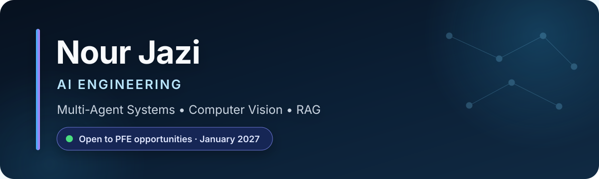

<!-- markdownlint-disable MD033 MD041 -->

  

  
  
  
  

  Final-year AI Engineering student at <strong>ESPRIT</strong> and Erasmus+ alumna of <strong>Université Côte d'Azur</strong>. 
  I build production-minded AI systems that combine intelligent agents, real-time vision, and grounded retrieval to solve practical problems.

## Selected work

| Project | What it delivers | Core stack |
|---|---|---|
| [**SOC Copilot**](https://github.com/Roua-Khalfet/internshipEY) · EY | Autonomous threat investigation combining XGBoost intrusion detection with a vulnerability knowledge base of **10,000+ CVE templates** | LangChain, XGBoost, FastAPI, Next.js, SQLite, GitHub Actions |
| [**Monkedh**](https://github.com/youssefbenlallahom/emergency-first-aid-app) · Ministry of Health partnership | Dual-agent emergency platform with a real-time CPR assistant running at **under 100 ms**, full-duplex voice AI, and hybrid RAG | CrewAI, LangChain, YOLOv8, PyTorch, Azure GPT-Realtime, Qdrant |
| [**PharmAI**](https://github.com/mazighahmed/AI_Project_pharmAI) · COGEPHA partnership | Multi-agent platform for inventory forecasting, prescription digitization, and skin analysis; reduced agent latency by **60%** | CrewAI, Llama 3, Groq, YOLOv8, OCR/NLP |
| [**VEO AI Recruitment**](https://github.com/youssefbenlallahom/VEO-Next-Js) · [backend](https://github.com/nourjazi01/veo-main) | End-to-end candidate screening, skill extraction, weighted evaluation, and explainable recommendations | FastAPI, Next.js, TypeScript, CrewAI, Azure AI, LLaMA 4 |
| [**PAC-MAN AI Research Platform**](https://github.com/nourjazi01/TER_S2_F) | Procedural maze generation and adversarial AI with Minimax, Alpha-Beta, Expectimax, BFS, Greedy, and A* | JavaScript, AI search, automated testing, CI/CD |

## Toolbox

**Languages & application development**

**AI, machine learning & data**

**Engineering tools**

## Highlights

- **1st place** - AI Camera Challenge, 2025
- **2nd place** - TuniHack 10.0, 2025
- **Top 10 university projects** - PharmAI and AzulTunes
- **NVIDIA certified** - Multimodal AI Agents, Generative AI with Diffusion Models, and Fundamentals of Deep Learning

## Current focus

- Building reliable agentic AI and RAG systems with clear evaluation and observability.
- Exploring real-time multimodal applications across healthcare and cybersecurity.
- Looking for a **six-month end-of-studies internship (PFE) starting January 2027**.

  <strong>Based in Tunis, Tunisia · Arabic (native) · English (C1) · French (B2)</strong>

